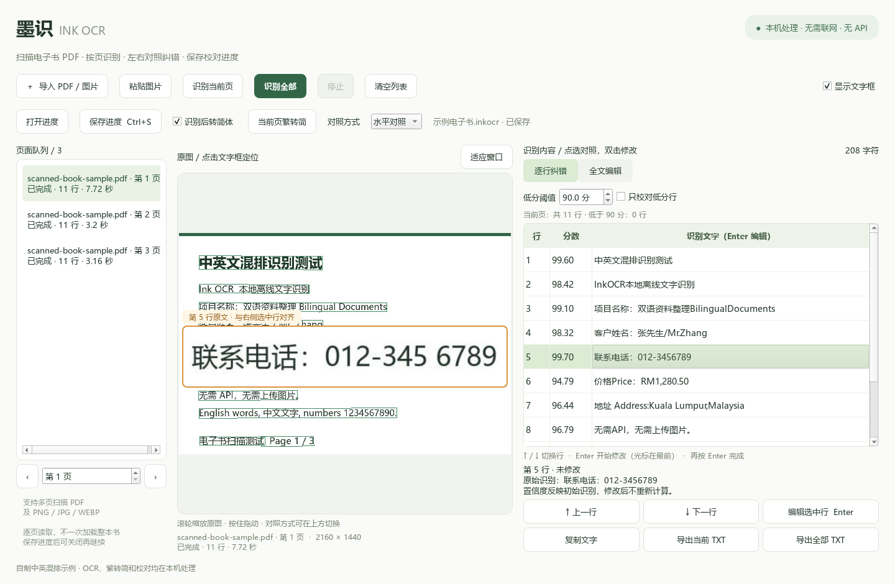

# Ink OCR

**Offline OCR and line-by-line proofreading for scanned Chinese–English books.**

[中文说明](README.md) · [Download Windows x64](https://github.com/adtham2023-spec/ink-ocr/releases/latest)

Ink OCR is a Windows desktop application that connects each recognized text line to its source image region. It runs local OCR models on the CPU and requires no API key or remote OCR service.



## Features

- Import multi-page scanned PDFs and common image formats. PDF pages are rendered on demand.
- Click a result line to highlight its source; click an image text region to select the matching result.
- Choose horizontal, eye-line-aligned magnification or a vertical original-above-result layout.
- Adjust a 0–100 confidence cutoff in 0.1-point increments, count low-score lines, and optionally proofread only those lines.
- Use Up/Down to navigate, Enter to edit at the beginning of a line, and Enter again to confirm and return to navigation. Escape cancels an unfinished edit.
- Convert recognized Traditional Chinese to Simplified Chinese locally with OpenCC, while retaining the original OCR text.
- Recognize one page or a batch, stop after the current page, and resume remaining pages without overwriting completed corrections.
- Save `.inkocr` progress, then autosave subsequent changes. Restore text, coordinates, page state and proofreading preferences.
- Copy or export complete corrected text as UTF-8 TXT. Filtering never removes high-confidence text from exports.

## Run

Download the ZIP from [Releases](https://github.com/adtham2023-spec/ink-ocr/releases/latest), extract the complete folder, and run its EXE. Keep the executable and `_internal` directory together. The packaged app includes its runtime and models.

For source usage, use Windows x64 and Python 3.12:

```powershell
git clone https://github.com/adtham2023-spec/ink-ocr.git
cd ink-ocr
py -3.12 -m venv .venv
.\.venv\Scripts\python.exe -m pip install -r requirements.txt
.\.venv\Scripts\python.exe app.py
```

Install `requirements-lock.txt` for the complete tested dependency set. Build a Windows distribution with `scripts/build_windows.ps1`; run regression tests with `python scripts/run_tests.py`.

## Important behavior

Save progress once before a long proofreading session. Progress files reference the original PDF/image path, so keep the original file in place. Clipboard images are embedded in saved progress. OCR confidence scores are not accuracy guarantees and do not change after manual corrections.

The current release exports TXT and project data. It does not reconstruct Word/EPUB layouts or produce searchable PDFs. Handwriting, rare Traditional Chinese characters, vertical text, complex columns and blurry scans need manual review. TIFF processing currently uses its first frame.

The screenshots and bundled examples use synthetic content created for this project.

## License

Original application code: [MIT](LICENSE). Dependencies, models and dictionaries retain their own licenses; see [third-party notices](THIRD_PARTY_NOTICES.md).
