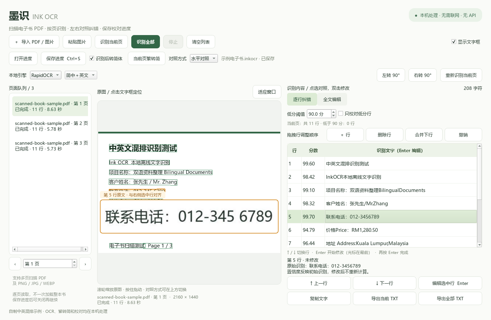
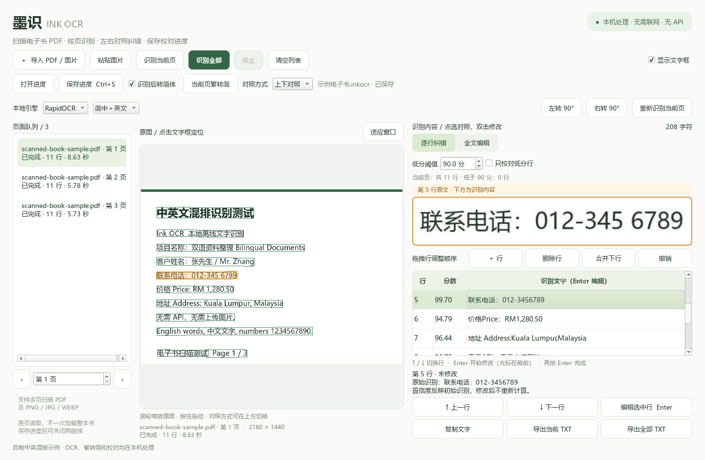
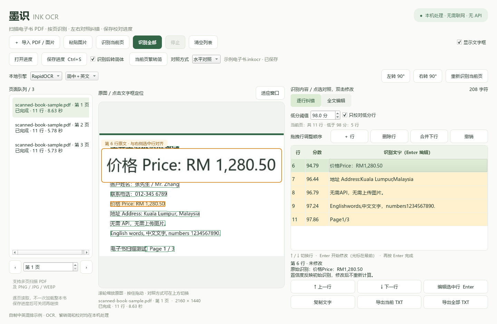
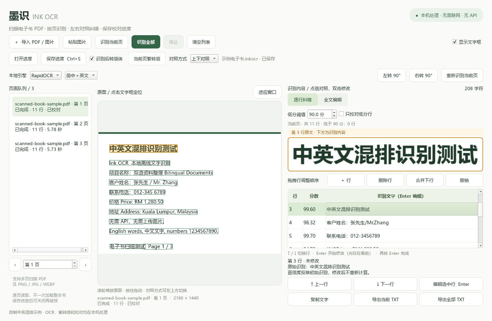
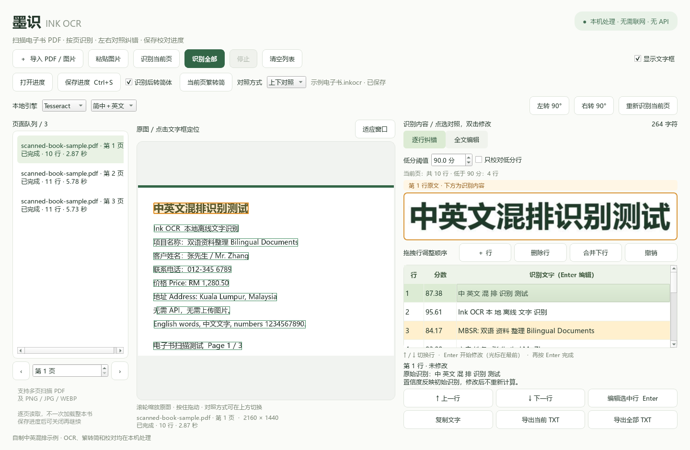

# 墨识 · Ink OCR

**把扫描电子书变成可逐行核对、修改和导出的文字。**

面向中英文混排扫描 PDF 的 Windows 离线 OCR 与人工校对工具。内置本地识别模型，无需 API、账号或访问令牌；支持按置信度筛选、键盘连续纠错、繁转简，以及水平／上下原文对照。

[下载 Windows 版](https://github.com/adtham2023-spec/ink-ocr/releases/latest) · [完整使用说明](docs/usage.zh-CN.md) · [技术讲解](docs/architecture.md) · [English](README.en.md)


## 为什么做这个工具

扫描版电子书常见的问题，不只是“识别出文字”，还包括如何快速找到错字、对照原文、分多次校对一本书。

墨识把原图位置、OCR 文字行和校对结果关联起来：点选识别行即可查看原文，修改后同步到全文、保存进度和 TXT 导出。你可以优先检查低分行，也可以完整逐行校对。

## 界面截图

所有截图均来自程序实际运行，使用本项目自制的中英混排示例，不包含用户电子书或私人校对数据。

### 水平对照：原文与选中行处于同一高度

左侧橙色原文预览会跟随右侧选中行，减少上下移动视线。



### 上下对照：原文在上，识别内容在下

从顶部“对照方式”切换布局，选择随校对进度保存。



### 按分数筛选：优先校对需要关注的行

阈值可在 0–100 分之间调整，支持 0.1 分精度。勾选“只校对低分行”后，列表与行导航一起筛选；全文与导出仍保留全部文字。



### 调整行序与切换离线引擎

拖拽移动整行，或用按钮修正漏行、多余行和拆行。顶部提供单页旋转和重新识别；下面是切换到内置 Tesseract 后的实际结果。




## 功能特点

| 功能 | 具体行为 |
| --- | --- |
| 本地离线识别 | 使用 RapidOCR + ONNX Runtime 在 CPU 上运行；模型随 Windows 发行包提供 |
| 切换本地引擎 | RapidOCR 与 Tesseract 5 二选一；Tesseract 提供简中＋英文、繁中＋英文及纯英文模型 |
| 调整行数和顺序 | 拖拽结果行调整阅读顺序；新增、删除或合并相邻行，同步全文与导出 |
| 单页旋转重识别 | 当前 PDF 页或图片可左／右转 90°，再单独重新识别；不会改写原始文件 |
| 撤销页面操作 | 行结构调整、旋转和重新识别保留最近 8 次快照，随进度保存，可逐步恢复 |
| 多页扫描 PDF | 导入后按物理页码列出页面，按需逐页渲染，不预先把整本书转成大图 |
| 中英文混排 | 处理中文、英文及数字印刷体；效果取决于扫描质量和版面 |
| 双向定位 | 右侧选行高亮原图；点击原图文字框选中对应识别行 |
| 两种原文对照 | 水平同行预览，或上下对照；支持原图缩放与拖动 |
| 分数筛选 | 调整阈值、实时统计本页低分行、标黄、只校对低分行 |
| 键盘纠错 | ↑／↓ 切行，Enter 进入编辑并将光标放在最前，再按 Enter 确认 |
| 连续跨页 | 本页最后一个待校对行之后，下一行会继续到后续页面；未识别页可自动处理 |
| 繁体转简体 | 新 OCR 结果可自动转简体；已识别页可以手动转换；保留原始 OCR 文本供对照 |
| 批量与续跑 | 识别当前页／全部页，在当前页完成后停止，继续时跳过已完成页 |
| 校对进度 | 保存 `.inkocr` 后自动更新，恢复页面、修改、文字框与设置；默认按原 PDF 文件名命名 |
| 完整文字导出 | 编辑全文、复制当前页、导出当前页或全部已识别页面为 UTF-8 TXT |

## 快速开始：直接使用 Windows 版

1. 打开 [Releases](https://github.com/adtham2023-spec/ink-ocr/releases/latest)，下载 Windows x64 ZIP。
2. **完整解压**，运行文件夹内的 EXE。移动程序时一起移动整个文件夹，保留 `_internal`。
3. 导入扫描 PDF，先点击 **保存进度**。默认名称是 `原PDF文件名.inkocr`。
4. 先用 **识别当前页** 检查效果，再按需识别全部页面。
5. 选中识别行，对照原文并修改，最后导出 TXT。

运行已打包程序不需要安装 Python，也不需要配置 API。首次安装源码依赖时需要联网下载软件包，之后可以本地运行识别。

可以先试用仓库内的 [三页扫描示例 PDF](examples/scanned-book-sample.pdf) 或 [中英混排示例图片](examples/bilingual-sample.png)。

## 键盘操作

| 场景 | 按键 | 效果 |
| --- | --- | --- |
| 逐行列表已选中一行 | ↑ / ↓ | 上一行／下一行，沿用低分筛选 |
| 行选择状态 | Enter | 编辑当前行，光标自动放在最前面，不全选文字 |
| 行编辑状态 | Enter | 确认修改、退出编辑并回到当前行 |
| 行编辑状态 | Esc | 取消本次尚未确认的修改 |
| 行编辑状态 | ← / →、Home、End | 移动文字光标 |
| 程序内 | Ctrl+O | 导入 PDF 或图片 |
| 程序内 | Ctrl+S | 保存校对进度 |
| 剪贴板有图片 | Ctrl+V | 导入剪贴板截图 |

中文输入法仍在组合文字时，确认候选字不会被当作结束整行编辑。全文编辑区中的 Enter 仍然正常换行，分数输入框中的 ↑／↓ 仍然调整分数。

## 从源码运行

当前发行面向 **Windows x64 + Python 3.12**。Qt 固定为 PySide6 6.8.3，这是本项目验证过的版本。

```powershell
git clone https://github.com/adtham2023-spec/ink-ocr.git
cd ink-ocr
py -3.12 -m venv .venv
.\.venv\Scripts\python.exe -m pip install -r requirements.txt
.\.venv\Scripts\python.exe scripts/fetch_tessdata.py
.\.venv\Scripts\python.exe app.py
```

需要重现完整的已验证依赖环境时，用 `requirements-lock.txt` 替代 `requirements.txt`。

源码首次准备 Tesseract 模型需要联网下载官方固定版本，并校验 SHA-256；完成后 OCR 离线运行。Windows 发行包已含两个引擎、三份语言模型及运行库，无需自行下载或安装 Tesseract。

## 修正歪页、错行和阅读顺序

1. 页面横着时，选中该页，点击“左转 90°”或“右转 90°”，直到原图朝向正确。
2. 选择本地引擎及语言，再点“重新识别当前页”。已有文字会提示替换，可以用“撤销”恢复。
3. 在逐行纠错列表中拖拽一整行，放到目标行上半部为放在其前，下半部为放在其后。原图定位框随文字一起移动；全文和 TXT 按新顺序输出。
4. 拆成两行的文字可选第一行后“合并下行”；缺行用“＋ 行”，多余行用“删除行”。合并前需取消低分筛选，避免看不到相邻行。新增行没有置信度或原图定位框。
5. “撤销”恢复当前页最近一次行结构调整、旋转或重新识别，最多 8 次；文本编辑仍可使用编辑框自身的撤销。

切换引擎只影响之后启动的识别任务。识别全部仍跳过已完成页；比较引擎效果请使用“重新识别当前页”。两种引擎的置信度标尺不同，切换后应重新调整校对阈值。横页应先旋正，旋转本身不会重新排版或重算 OCR。

也可以传入文件路径：

```powershell
.\.venv\Scripts\python.exe app.py "C:\Books\扫描电子书.pdf"
.\.venv\Scripts\python.exe app.py "C:\Books\扫描电子书.inkocr"
```

## 构建 Windows 发行包

```powershell
.\.venv\Scripts\python.exe -m pip install -r requirements-lock.txt
& .\scripts\build_windows.ps1
```

构建结果为 `dist/InkOCR/InkOCR.exe` 和 `dist/InkOCR-Windows-x64.zip`。打包脚本会收集模型、PDF 渲染引擎、OpenCC 字典、动态 Qt 库和第三方许可，并附上源码。

## 测试

```powershell
.\.venv\Scripts\python.exe scripts/fetch_tessdata.py
.\.venv\Scripts\python.exe scripts/run_tests.py
# 只运行界面交互回归
.\.venv\Scripts\python.exe scripts/run_tests.py --suite ui
```

测试在独立临时目录中生成自制样本，验证本地 OCR、PDF 分页、停止／续跑、进度恢复、分数筛选、键盘编辑、原文对齐和布局切换。测试不会读取你的电子书或现有校对进度。

## 使用边界

- 当前支持 PDF、PNG、JPEG、BMP、WEBP、TIFF；多页 TIFF 仅首帧。
- 主要面向清晰的中英文印刷体。繁体生僻字、模糊小字、手写、竖排、多栏及双页摊开的书页需要人工复核；繁转简不能修复识别错字。
- 分数是 OCR 模型的置信度，不是正确率保证。人工修改后不会重新计算；“低于阈值”不包括等于阈值的行。
- 当前导出为 TXT 和 `.inkocr`，不提供 Word／EPUB 排版还原或可搜索文字层 PDF 导出。
- 进度引用原文件路径，请保留原 PDF／图片及其所在位置；已移动或已更改的文件可能无法恢复对照。
- PDF 页码是物理页码，可能与书内印刷页码不同；加密 PDF 请先解锁。

更多说明见 [操作教程](docs/usage.zh-CN.md)、[常见问题](docs/faq.zh-CN.md) 和 [技术讲解](docs/architecture.md)。

## 开源与致谢

本项目原创代码采用 [MIT License](LICENSE)。依赖、OCR 模型及字典遵循各自许可证，详见 [第三方说明](THIRD_PARTY_NOTICES.md) 与发行包内的许可文件。

感谢 [RapidOCR](https://github.com/RapidAI/RapidOCR)、[PaddleOCR](https://github.com/PaddlePaddle/PaddleOCR)、[ONNX Runtime](https://github.com/microsoft/onnxruntime)、[pypdfium2](https://github.com/pypdfium2-team/pypdfium2)、[PySide6](https://code.qt.io/cgit/pyside/pyside-setup.git/) 和 [OpenCC Python](https://github.com/yichen0831/opencc-python)。

欢迎通过 [Issues](https://github.com/adtham2023-spec/ink-ocr/issues) 反馈问题或提交改进，参与方式见 [CONTRIBUTING.md](CONTRIBUTING.md)。
