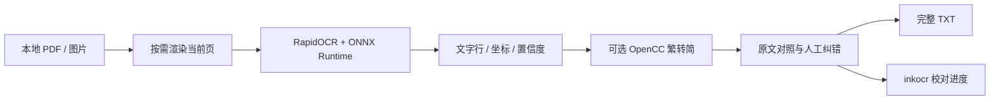

# 技术讲解：墨识如何工作

## 处理流程



本项目的重点是 OCR 后的校对工作流。识别模型、PDF 渲染和中文转换分别由对应的开源组件完成。

## PDF 按页读取

`read_source()` 使用 pypdfium2 渲染指定的物理页，不在导入时保存整本书的页面图。当前渲染比例不超过 3 倍，最长边限制在约 3200 像素；原图显示和 OCR 使用相同的坐标空间。

PDFium 调用通过进程内的可重入锁串行保护，避免界面预览与后台 OCR 同时访问非线程安全的 PDF 引擎。渲染资源在转换成独立的图像数组后关闭。

## 识别任务与页面状态

`OCRWorker` 在 QThread 中运行，复用一个 RapidOCR 引擎。任务按页处理，通过 Qt 信号回传结果和进度。

停止是协作式的：完成当前页后停止，后续页继续处于待识别状态。批量任务只选择待识别页和失败页，跳过已完成页，保留人工修改。

当前配置运行本地 CPU 推理。模型来自 `rapidocr-onnxruntime` 的内置模型资源，打包时一并收集。

## 行记录和原文定位

每一行保存原始 OCR 文字、当前校对文字、四边形坐标以及初始置信度。`Preview` 使用 QGraphicsView 显示整页和文字框，表格行号继续对应原图记录，筛选不会重新编号或删除内容。

选择表格行时，程序高亮对应区域，并从当前页原图中截取放大预览。点击原图文字框则反向选择行。

水平模式把预览的垂直中心对齐到表格选中行。滚动、窗口尺寸变化和栏宽变化会触发合并后的布局更新；预览图按内容与尺寸缓存，避免空闲时不断重绘。上下模式将同一个预览组件放入识别列表上方的容器。

## 编辑与过滤

`ReviewTable` 处理行选择状态的 ↑／↓ 和 Enter；`CorrectionDelegate` 管理单行编辑、确认、取消及中文输入组合状态。确认使用不自动跳行的关闭方式，随后把焦点还给列表。

分数筛选隐藏表格中的高分行，并改变校对导航的候选行。它不改变完整文本。没有分数的人工新增行会保留在校对列表中。

全文编辑使用序列匹配保留未改动行及一对一修改行的坐标。结构发生变化、无法可靠映射到原图的新增／合并文字会取消坐标关联，避免显示错误的原文位置。

## 繁转简

OpenCC 的 `t2s` 配置在本地处理识别文本。界面保留原始 OCR 文字，供人工核对。繁转简与 OCR 是两件事：文字转换不能推断或修复模型识别错字。

## 保存校对进度

`.inkocr` 是 UTF-8 JSON，目前内部格式版本为 `3`。格式版本与界面迭代版本不是同一个编号。

进度记录页面文本、行坐标、原文件路径与文件状态、当前页及界面设置。普通 PDF／图片不嵌入进度，剪贴板图片会嵌入。

首次保存由用户选择位置，后续更改通过定时器合并写入。保存先在目标目录写临时文件，刷新后以原子替换更新目标文件，减少中断写入破坏上次保存的风险。

恢复时检查原文件路径、大小、修改时间及 PDF 页码范围。它不是跨电脑自包含项目格式；原文件移动后，需要恢复原路径才能继续对照。

## 源码结构

```text
app.py                    主程序、OCR 任务、校对组件和保存逻辑
assets/ink.ico            应用图标
examples/                 自制中英文图片与三页扫描样本
tests/                    界面和识别回归脚本
scripts/run_tests.py       隔离测试入口
scripts/build_windows.ps1 Windows 构建入口
scripts/package_release.py 发行包与依赖许可收集
docs/screenshots/         实际运行截图
```

当前程序保留为单文件实现，便于直接运行和审阅。后续可以把 OCR、项目保存和界面组件拆分为独立模块。
