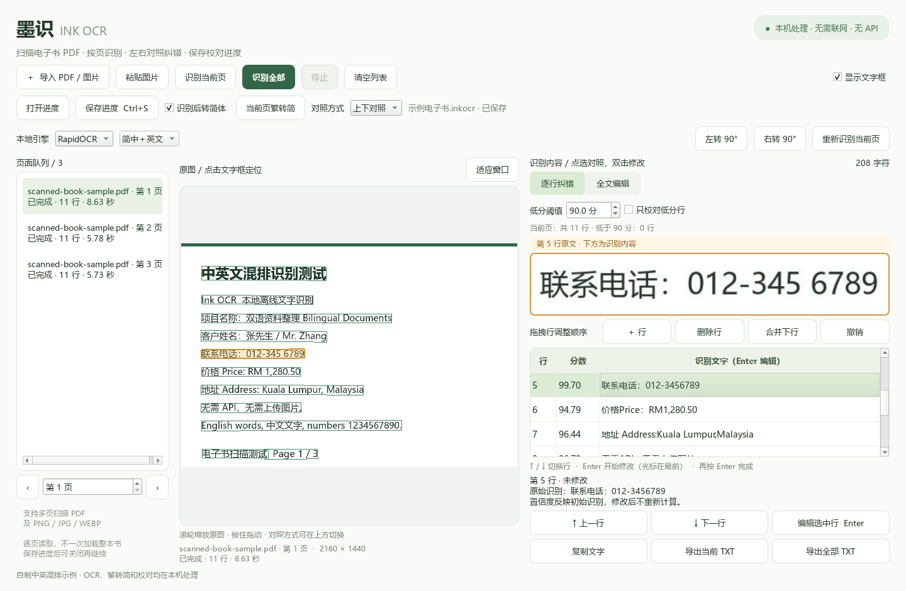
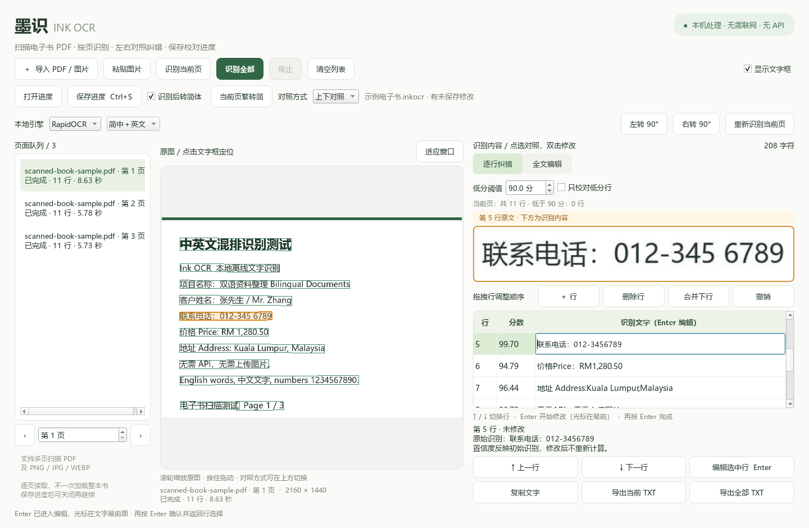
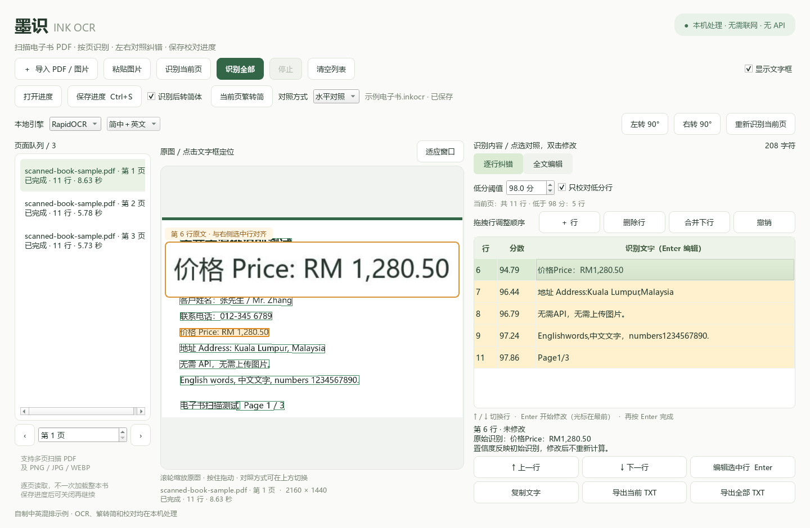

# 从扫描 PDF 到校对后的文字

## 1. 导入整本书

点击“导入 PDF / 图片”，或把本地文件拖入窗口。左侧按原 PDF 的物理页码列出页面。

导入不会立即识别全书，也不会预先渲染所有页面。点击左侧页面、页序号或左右翻页按钮，可以先检查原图。

想先试用时，可打开仓库的 `examples/scanned-book-sample.pdf`。这是三页自制扫描样本。

## 2. 先保存校对进度

点击“保存进度”或按 Ctrl+S，选择保存位置。默认名称是 `原PDF文件名.inkocr`。

第一次保存之后，识别结果、校对修改和设置会自动更新到该文件；更改通常会在约 1 秒后保存，一批识别结束时也会保存。当前保存状态显示在顶部。

进度包括页面文本、原始 OCR 文字、文字框、识别状态、当前页以及分数／繁转简／对照模式设置。**请保留原 PDF 及原路径**，进度文件需要它来显示原文。

## 3. 选择识别范围

- “识别当前页”：先处理一页，适合检查书籍的扫描质量。
- “识别全部”：处理队列中的未完成页和失败页，跳过已经完成的页面。
- “停止”：等当前页完成后停止。再次识别全部即可继续剩余页面。

已完成的页面不会重复识别，也不会因此覆盖人工校对结果。

如果开启“识别后转简体”，新结果会在本机转换为简体；已识别的页面可用“当前页繁转简”。关闭选项不会把已转换的简体反向改为繁体。

## 4. 对照原文

在右侧单击一行，左侧会高亮其对应的原图位置。也可以反过来点击原图文字框定位识别行。原图支持滚轮缩放、按住拖动和“适应窗口”。

顶部“对照方式”可以随时切换：

| 模式 | 原文预览位置 | 适用习惯 |
| --- | --- | --- |
| 水平对照 | 左侧，和右侧选中行保持同一高度 | 左右移动视线核对 |
| 上下对照 | 识别列表上方 | 上下对照原文与文字 |

水平模式中，选中行滚出可见列表后，浮动预览会暂时隐藏，避免对到其他行。上下模式通过键盘切行时，会尽量将选中行放到列表顶部。

## 5. 用键盘逐行修改

1. 选中一行，按 ↑／↓ 切换要校对的行。
2. 按 Enter 进入编辑，光标在文字最前面，不会自动全选原文。
3. 用左右方向键、Home、End 移动光标，输入正确内容。
4. 再按 Enter 确认。程序退出编辑，停在当前行，焦点返回列表。
5. 继续按 ↓ 校对下一行。

Esc 取消本次尚未确认的修改。数字小键盘 Enter 也可使用。编辑过程中 ↑／↓ 不会切换到其他行，中文输入法组合文字的确认也不会误结束整行。

本页最后一个待校对行之后，继续“下一行”会进入后续页面。遇到未识别页时会自动识别该页；如果其他识别任务正在进行，会在其结束后处理。

双击或点击“编辑选中行”也能修改。右侧“全文编辑”适合整页调整；普通 Enter 在全文编辑区仍然换行。

## 6. 优先校对低分行

“低分阈值”支持 0–100 分，精确到 0.1 分。分数是 OCR 的原始行级置信度乘以 100，人工修改后不重新计算。

例如设置为 **90 分**：

| 行分数 | 是否标黄／属于低分行 |
| --- | --- |
| 88.50 | 是 |
| 90.00 | 否，等于阈值不计入 |
| 97.20 | 否 |

勾选“只校对低分行”后：

- 列表只显示低分行，上一行／下一行也跳过高分行。
- 后续已识别且没有符合条件行的页面会跳过。
- 手动新增且没有 OCR 分数的行仍显示，并单独计数。
- 全文、复制、导出和进度仍保留所有文字，不会删除高分行。

一页没有低分行时，可以调高阈值、关闭筛选，或继续下一行。分数不是正确率保证；重要内容仍可完整复核。

## 7. 导出与下次继续

“导出当前 TXT”导出当前页；“导出全部 TXT”按页面顺序导出已识别且有文字的页面，并保留页码分隔。文件采用带 BOM 的 UTF-8，便于 Windows 文本编辑器读取中文。

下次用“打开进度”载入 `.inkocr`，或者通过命令行把该文件作为启动参数，即可继续。旧版进度也能打开。

全文中增行、并段或拆段后，某些文字可能不再有原图坐标，仍可编辑和导出。进度文件包含原路径和识别内容，应与原文件一样妥善保管。

## 8. 旋转、重新识别和更换引擎

横着的页面先用顶部“左转 90°”或“右转 90°”旋正，再按“重新识别当前页”。只处理当前页，旋转角度随进度保存，原 PDF 不会改写。已有内容的页面会在替换前提示。

“本地引擎”可选 RapidOCR 或 Tesseract。RapidOCR 使用内置中英文模型；Tesseract 可选简中＋英文、繁中＋英文或纯英文。切换只影响之后的识别，批量识别仍跳过已完成页。两个引擎的分数含义不同，比较结果后请按实际情况调整阈值。

## 9. 拖拽行、修正行数和撤销

在逐行列表拖动一行，橙色插入线表示落点，靠近列表上下边缘时会自动滚动。拖到某行上半部为放在其前，下半部为放在其后。文字、分数和原图坐标一起移动，全文和导出同步采用新顺序。

“＋ 行”在选中行后加入空行并进入编辑；“删除行”移除选中行；“合并下行”将本行和下一行合成一行。合并前请取消低分筛选，确认相邻内容。新增行无 OCR 分数与定位框；两行均有坐标时合并框取两者的包围矩形。

“撤销”恢复当前页最近一次行结构、旋转或重新识别前的页面快照，包括该快照的文字和坐标。每页最多保留 8 次，随进度一起保存；编辑框中的文字撤销仍由编辑框自身处理。
